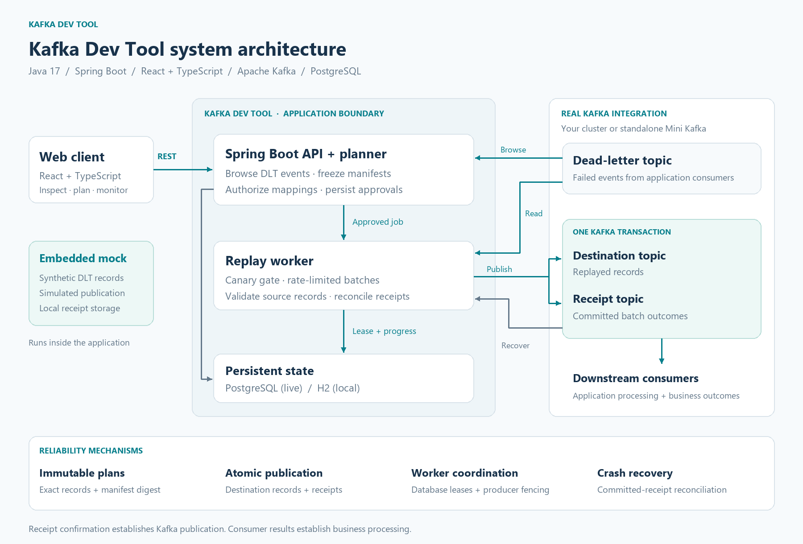

## Index

Skip to your preferred section below.

1. [Architecture diagram](#architecture-diagram)
2. [Demo video](#demo-video)
3. [Run it yourself](#run-it-yourself)

<a name="architecture-diagram"></a>



[View scalable architecture diagram](docs/images/system-architecture.svg)

# Kafka Dev Tool

Inspect Kafka dead-letter records, preview and approve replay plans, then run a canary before releasing the remaining messages.

## Demo video

The demo video will be uploaded soon.

## Run it yourself

Install Git and JDK 17 or newer. On Windows, open PowerShell:

```powershell
git clone https://github.com/Swaroopnarasimha007/kafka-replay-dev-tool.git
cd kafka-replay-dev-tool
./scripts/setup-console.ps1
./scripts/start-console.ps1
```

The Maven wrapper downloads build dependencies and builds the React UI. Open **http://localhost:8088**. In another terminal, read the generated login:

```powershell
Get-Content ./data/console-login.json
```

In **Connection**, select **Built-in mock**, then **Continue to records** and **Browse records**. Mock data and simulated replay run inside Kafka Dev Tool without a Kafka broker. Mock timestamps are fixed sample dates, so leave time filters empty initially. The default local profile also lets you add real PLAINTEXT clusters alongside the mock.

Stop with Ctrl+C. Local connections and jobs persist in `data/`. Run one tool instance per data directory. To change the HTTP port, run `./scripts/start-console.ps1 -ConsolePort 8089`.

For macOS/Linux with JDK 17+, build and run from the repository root:

```sh
sh ./mvnw -B -DskipTests package
export LAB_PASSWORD='replace-with-a-unique-password-at-least-12-characters'
java -jar target/replay-console.jar --spring.profiles.active=lab --server.port=8088
```

Log in with username `lab` and the password you set. Existing script, JAR and configuration identifiers retain their compatibility names.

## Try a real connection with Mini Kafka

Mini Kafka is a separate test application with a real Kafka broker, two order producers and two consumers. It generates processing failures and dead-letter records.

1. Keep Kafka Dev Tool running in the first terminal with `./scripts/start-console.ps1`, the same command used for the mock.
2. Open a second PowerShell terminal at the repository root and start Mini Kafka. The first run builds the application if needed.

   ```powershell
   ./scripts/start-mini-kafka.ps1
   ```

3. In the tool's **Connection** tab, select **Mini Kafka implementation** to prefill `localhost:19092` and `PLAINTEXT`. Choose **Test connection**, then **Save and open**. Browse `orders.DLT` once the test application produces failed records.
4. Stop Mini Kafka with Ctrl+C in its terminal or run `./scripts/stop-mini-kafka.ps1` from another terminal at the repository root. Kafka Dev Tool can stay running.

See [how to check Mini Kafka details](docs/MINI_KAFKA.md) for connection metadata, event logs and replay scenarios.

## Connect your own local Kafka cluster

1. Obtain the broker bootstrap endpoints, such as `localhost:9092`. Use Kafka endpoints, not an HTTP management dashboard URL.
2. Ensure all broker `advertised.listeners` addresses are reachable from the machine running Kafka Dev Tool.
3. For hostnames beyond the default `localhost`, `127.0.0.1` and `kafka`, set the allowlist before starting the tool:

```powershell
$env:REPLAY_ALLOWED_HOSTS='localhost,127.0.0.1,broker-a.example.com,broker-b.example.com'
./scripts/start-console.ps1
```

4. In **Connection**, select **New connection** and enter a name, comma-separated `host:port` endpoints and `PLAINTEXT`. Click **Test connection**, then **Save and open**. A successful test expires after five minutes.
5. Browse an allowed dead-letter topic. Discovery defaults to the topic policy in `src/main/resources/application.yml`. Configure `replay.topic-pattern` or `replay.topics` for other topic names.

The local profile supports PLAINTEXT. Secured clusters use the live setup below.

## Connect a secured local or cloud Kafka cluster

The live profile supports **SASL_SSL with SCRAM-SHA-512**. Check your provider's listener and authentication settings first. IAM, OAuth Kafka authentication, SASL/PLAIN and client-certificate authentication require additional implementation.

Prepare PostgreSQL and an OIDC application. Set these environment variables in the terminal that starts the tool:

- `REPLAY_DB_URL` (for example `jdbc:postgresql://localhost:5432/replay`), `REPLAY_DB_USER`, `REPLAY_DB_PASSWORD`.
- `REPLAY_OIDC_ISSUER`, `REPLAY_OIDC_CLIENT_ID`, `REPLAY_OIDC_CLIENT_SECRET`. Configure the redirect URI `http://localhost:8088/login/oauth2/code/console` for local use and supply a `roles` claim containing `Admin`, `Operator` or `Viewer`. An Admin registers connections.
- `REPLAY_ENCRYPTION_KEY`, a persistent base64-encoded 32-byte random key used to encrypt saved credentials.
- `REPLAY_ALLOWED_HOSTS`, a comma-separated list of every bootstrap and advertised broker hostname.
- `REPLAY_WORKER_ENABLED=true` when you want to execute approved replays.

Generate an encryption key once, then store it securely and reuse it across restarts:

```powershell
$keyBytes = New-Object byte[] 32
[System.Security.Cryptography.RandomNumberGenerator]::Create().GetBytes($keyBytes)
$env:REPLAY_ENCRYPTION_KEY = [Convert]::ToBase64String($keyBytes)
```

After building with the setup script, start live mode directly:

```powershell
java -jar ./target/replay-console-lab.jar --spring.profiles.active=live --server.port=8088
```

Open the tool and sign in. In **Connection**, supply the bootstrap endpoints, `SASL_SSL`, browse username/password, optional PEM CA chain, and separate replay username/password. Choose **Test connection**, then **Save and open**. Live mode exposes real connections only.

The tool's server needs network access to every advertised broker, including any required VPN, firewall or cloud security-group access. Browse credentials need topic metadata and read permissions. Replay credentials need source reads, destination writes, transactional-ID permissions and read/write access to the receipt topic. Have your Kafka administrator provision `_replay_console_receipts` with one partition, delete-only cleanup, at least seven days of time retention and unlimited byte retention. Pre-create destination topics. See [release operations](docs/RELEASE_RUNBOOK.md) for recovery and authorization details.

## Replay workflow

Browse records, create an authorized source-to-destination mapping, freeze a preview and approve it. In Jobs, start the canary, inspect downstream consumer results, then release the remaining records. Receipts confirm Kafka publication. Your consumer's logs confirm application processing.

## Independent Docker setups

For the tool alone, set `LAB_PASSWORD` to at least 12 characters and run `docker compose up --build` from this directory. Open http://localhost:8088 with username `lab`. Mock mode works immediately. The tool stores its data in its own Docker volume.

Mini Kafka has its own Compose setup described in its README. For real connections across containers or hosts, configure Kafka's advertised addresses and the tool's allowlist so every broker is reachable from the tool container. `localhost` inside a container refers to that container.

## Development

```powershell
./mvnw.cmd -B verify
```

Tests include embedded-broker integration and replay recovery cases. Historical implementation notes and captured evidence live under `docs/`; use this README for current startup instructions. Docker and cloud deployment require verification in your target environment.
